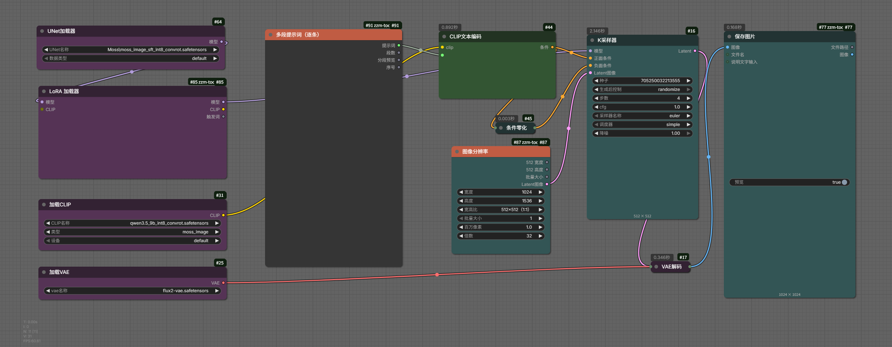

# comfyui-zzm · zzm 工具箱

一套自用的 ComfyUI 自定义节点，覆盖出图流程里最常手动操作的那几步：**算分辨率、批量喂提示词、从文件夹取图、挂 LoRA、按原名存图**。

8 个后端节点 + 1 组纯前端节点（Set / Get）。除 ComfyUI 自带的 `torch` / `numpy` / `Pillow` 外**没有额外依赖**，不需要 `pip install`。

## 安装

把整个 `zzm-toolbox` 目录放进：

```
ComfyUI/custom_nodes/zzm-toolbox
```

重启 ComfyUI。节点会出现在左侧节点库的 **⚡ zzm工具箱** 分类下。

前端资源注册在 `/extensions/zzm-toolbox/`，由 `__init__.py` 里的 `WEB_DIRECTORY` 声明。

在节点搜索框输入 `zzm` 可以一次列出全部节点（走 `SEARCH_ALIASES`，不影响节点显示名）。

## 节点一览

| 节点                  | 类型 ID                   | 作用                          |
| ------------------- | ----------------------- | --------------------------- |
| 图像分辨率               | `ZZM Aspect Ratio`      | 由宽高比 + 百万像素算出宽高，顺带给空 Latent |
| 遮罩填洞                | `ZZM Mask Fill Holes`   | 填掉遮罩里的孔洞                    |
| 多段提示词（逐条）           | `ZZM Prompt List`       | 一段文本切成 N 条，一条跑完自动排下一条       |
| 多段提示词·列表模式          | `ZZM Prompt List Batch` | 一次把 N 条全展开（会占显存）            |
| 图片文件夹               | `ZZM_NODES_ImageFolder` | 从 input / output 目录挑图，批量出图  |
| LoRA 加载器            | `ZZM_NODES_LoraLoader`  | 多 LoRA 叠加，带触发词输出            |
| 保存图片                | `ZZM_NODES_SaveImage`   | 存图，可沿用源文件名、写说明文字            |
| 设置 (Set) / 获取 (Get) | 纯前端                     | 跨节点传参，不用拉长线                 |

---

## 图像分辨率

两种用法，二选一：

- **固定宽高比** → 由「百万像素」算尺寸，每条边再取到「倍数」的整数倍。「宽度」「高度」两栏会被忽略。
- **自定义** → 直接用「宽度」「高度」，百万像素和倍数不参与。

## 遮罩填洞

输入遮罩里如果有零星小孔，这个节点把它们填实（二值化 + 连通域判断）。

## 多段提示词（逐条）

把一段长文本按空行 / 换行 / 空格 / 自定义分隔符切成 N 条，**每次只让一条通过**，跑完整条工作流 → 存图 → 自动排下一条。

为什么不用 ComfyUI 的 list 展开：内核的 list 展开是"按节点"展开的，58 条的 conditioning 全部编码完才去采样，所有中间结果累积到最后一个节点，条数一多必爆显存。这里包了一层 `PromptQueue.task_done`，对 ComfyUI 来说就是 N 个连续的独立任务，**显存占用与单张出图完全相同**。

| 输入        | 说明                      |
| --------- | ----------------------- |
| 文本        | 要切分的原文                  |
| 分隔方式      | 自动 / 空行 / 每行 / 空格 / 自定义 |
| 自定义分隔符    | 分隔方式选"自定义"时生效           |
| 当前索引      | 当前是第几条                  |
| 统一前缀 / 后缀 | 可选，每条自动套上               |
| 去重 / 最大条数 | 可选                      |

| 输出   | 说明             |
| ---- | -------------- |
| 提示词  | 当前这一条          |
| 段数   | 一共切出多少条        |
| 分段预览 | 切分结果预览         |
| 序号   | 当前条序号，可接「保存图片」 |

## 多段提示词·列表模式

同样的切分逻辑，但一次把 N 条全部输出成列表（`OUTPUT_IS_LIST`）。**所有结果会驻留内存**，条数多时注意显存。

## 图片文件夹

从 ComfyUI 的 `input` 或 `output` 目录里挑图，勾选后批量出图。面板上可以直接看缩略图。

- **一次全部**：点一次运行，勾选的每张图各跑一遍
- **每次一张**：每次运行只加载一张，跑完自动往后走，某张失败只跳过它自己

| 输出      | 说明               |
| ------- | ---------------- |
| 图像 / 遮罩 | 当前这张             |
| 文件名     | 原始文件名，接「保存图片」可沿用 |
| 序号 / 总数 | 当前进度             |

工具栏的 **清空** 按钮可以把已载入的文件夹清掉，面板回到空白（状态存进节点属性，重开工作流仍然是空的），点 `↻` 或另选文件夹恢复。

文件夹只能是 ComfyUI 目录内的；别处的文件夹拖到节点上会先复制进 `input`。

## LoRA 加载器

多 LoRA 叠加，强度可单独调，额外输出触发词。

| 输出        | 说明                  |
| --------- | ------------------- |
| 模型 / CLIP | 打过 LoRA 的           |
| 触发词       | 所选 LoRA 的触发词，按分隔符拼接 |

## 保存图片

存图，可选沿用源文件名、写说明文字（caption）、按日期/尺寸/批次号命名。

可选择是否保存数据到图片，可选择图片格式。

## 设置 / 获取（纯前端）

`Set_变量名` ↔ `Get_变量名` 配对传参，免去跨节点拉长线。这两个节点只在画布上存在，不参与执行。

---

## 示例工作流



`example_workflows/Moss-SFT-test.json` —— Moss-SFT 文生图，用「多段提示词」一次跑完多段文案。

**需要的模型**（放到 ComfyUI 对应目录）：

| 类型 | 文件 | 目录 |
|---|---|---|
| UNET | `moss_image_sft_int8_convrot.safetensors` | `models/diffusion_models/Moss/` |
| CLIP | `qwen3.5_9b_int8_convrot.safetensors` | `models/text_encoders/` |
| VAE | `flux2-vae.safetensors` | `models/vae/` |
| LoRA | `lodestones-8-steps-dmd2-lora-*.safetensors` | `models/loras/Moss/` |

流程：加载 CLIP / UNET / VAE → LoRA 加载器 → **多段提示词（逐条）** 把文本按空行切成多段 → **图像分辨率** 给出 512×512 → KSampler（4 步、CFG 1.0、euler / simple）→ 保存图片。

点一次 Run 会依次跑完所有段落（一条跑完自动排下一条，显存占用等同单张）。想从某一段开始，把「多段提示词」的「当前索引」改成对应条号；想中途停下就点取消。

> 工作流里的提示词是示例文案，换成自己的即可。

## 目录结构

```
zzm-toolbox/
├── __init__.py                  节点注册、前端目录声明
├── nodes_resolution.py          图像分辨率
├── nodes_mask_fill_holes.py     遮罩填洞
├── nodes_prompt_list.py         多段提示词 ×2
├── ausport/
│   ├── node_image_folder.py     图片文件夹
│   ├── node_lora_loader.py      LoRA 加载器
│   ├── node_save_image.py       保存图片
│   └── _*.py                    上面三个的内部 helper
├── example_workflows/
│   ├── Moss-SFT-test.json       示例工作流（Moss-SFT 文生图）
│   └── workflow.png             示意图
└── web/js/
    ├── resolution_preview.js    分辨率数值显示
    ├── prompt_list.js           提示词面板
    ├── set_get_nodes.js         Set / Get 节点
    ├── zzm_brand.js             节点配色与中文标签
    ├── zzm_theme.mjs            配色主题
    └── ausport/                 ausport 三个节点的面板
```

## 致谢

- `ausport/` 下的**图片文件夹 / LoRA 加载器 / 保存图片**移植改造自 [ComfyUI-AusBoss](https://github.com/ausboss/ComfyUI-AusBoss)（MIT），保留了原作者的前端组件与后端结构，只改了文案、配色和命名空间。
- 整体**配色风格**参考 Pixaroma。

## License

[MIT](LICENSE)
